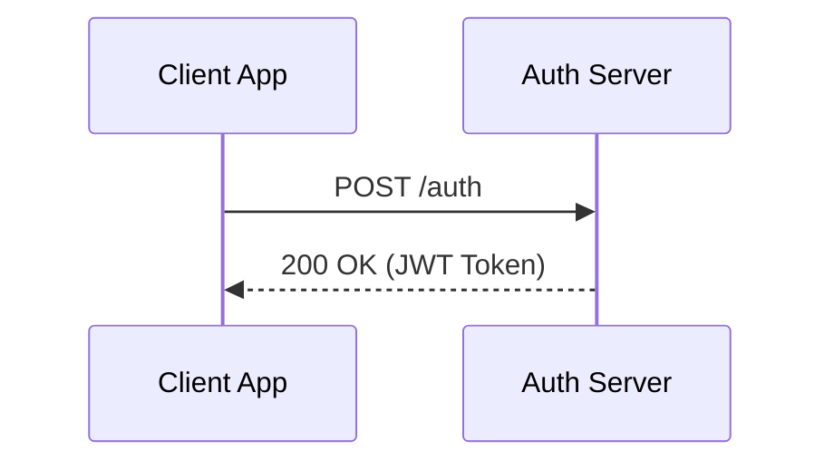

# Presenterm Presentation Authoring Skill

This skill guides the agent in authoring, structuring, and verifying terminal-based presentations using `presenterm`.

---

## 1. Core Principles & Presentation Structure

`presenterm` is a high-performance terminal slideshow tool written in Rust that renders Markdown slides directly in the terminal using protocols like Kitty Graphics, iTerm2, Sixel, and ASCII fallback.

### Core Syntax & Markdown Guidelines
> [!IMPORTANT]
> - **Code Block Placement**: Place code blocks at the root slide level (0 indentation). When displaying code alongside list items, place the code block between separate list sections.
> - **Speaker Notes Syntax**: Always wrap speaker note content in double quotes: `<!-- speaker_note: "Your speaker notes here..." -->`. This is required for YAML parsing, especially when text contains colons or special characters.
> - **Incremental Lists Syntax**: Specify an explicit boolean value for incremental lists: `<!-- incremental_lists: true -->` (or `<!-- incremental_lists: false -->`).
> - **Slide Delimiters**: Delimit slides using `<!-- end_slide -->`.

### File Structure & Frontmatter
Every deck begins with a YAML frontmatter block. `presenterm` automatically builds a standardized title slide (introduction slide) when these properties are defined:

```markdown
---
title: "Distributed System Architecture"
sub_title: "Design Principles & Operations 2026"
authors:
  - "Alice Smith"
  - "Bob Jones"
theme:
  name: catppuccin-mocha
---
```

*(Optional: Configure separate light and dark themes based on terminal background)*:
```yaml
theme:
  light: catppuccin-latte
  dark: catppuccin-mocha
```

### Slide Delimiters & Headings
- **Slide Delimiters**: Delimit and end slides using the `<!-- end_slide -->` comment command.
- **Slide Titles (Setext Level 1)**: Presenterm recognizes Setext level 1 headings (`===` directly underneath the title line). When encountered, it vertically and horizontally centers the title, adds padding, and highlights it with the theme's accent color.

```markdown
System Architecture Overview
============================
```

---

## 2. Layout & Comment Commands Reference

Presenterm uses HTML comment commands (`<!-- command -->`) for slide control without introducing HTML tree tags into Markdown.

| Command | Scope | Functionality |
| :--- | :--- | :--- |
| `<!-- end_slide -->` | Current line | Delimits and ends the current slide. |
| `<!-- pause -->` | Current line | Halts rendering until next step keypress. |
| `<!-- incremental_lists: true\|false -->` | Rest of slide | Toggles automatic pause between each list bullet (requires boolean). |
| `<!-- list_item_newlines: N -->` | Rest of slide | Inserts `N` blank lines between list items for spacing. |
| `<!-- column_layout: [w1, w2, ...] -->` | Layout block | Splits terminal width into columns using relative integer weights (e.g. `[1, 1]` or `[1, 2]`). |
| `<!-- column: N -->` | Layout block | Directs subsequent Markdown content to column index `N` (0-based). |
| `<!-- reset_layout -->` | Rest of slide | Closes multi-column mode and restores full slide width. |
| `<!-- jump_to_middle -->` | Current line | Shifts vertical rendering point down to middle of slide. |
| `<!-- new_line -->` / `<!-- newlines: N -->` | Current line | Forces insertion of 1 or `N` blank lines. |
| `<!-- alignment: left\|center\|right -->` | Rest of slide | Sets horizontal alignment for all subsequent elements. |
| `<!-- font_size: 1-7 -->` | Rest of slide | Changes font scale (supported on Kitty v0.40.0+). |
| `<!-- include: path/to/file.md -->` | Insertion point | Directly embeds an external Markdown file at that position. |
| `<!-- no_footer -->` | Entire slide | Hides footer on the current slide. |
| `<!-- skip_slide -->` | Entire slide | Excludes current slide from the running presentation. |
| `<!-- speaker_note: "..." -->` | Current slide | Attaches speaker note text to slide for UDP broadcast (wrap text in double quotes). |

### Column Layout Pattern
```markdown
Architecture & Code
===================

<!-- column_layout: [1, 1] -->
<!-- column: 0 -->

### Service Responsibilities
* Ingests messages from Kafka.
* Enforces validation logic.
* Dispatches async worker tasks.

<!-- column: 1 -->

```rust +line_numbers
fn handle_event(msg: Message) -> Result<(), Error> {
    validate(&msg)?;
    dispatch(msg)
}
```

<!-- reset_layout -->

This text spans the full width again below the columns.
```

---

## 3. Code Blocks: Highlighting & Execution

Syntax highlighting uses `bat` engine (50+ programming languages supported).

### Line Numbers & Selective / Dynamic Highlighting
- `+line_numbers`: Displays line numbers.
- `{range}`: Selective highlighting. Dim unselected lines to direct focus.
- `{frame1|frame2|...|all}`: Dynamic highlighting. Progresses highlight frames step-by-step on keypress without duplicating code blocks.

```rust +line_numbers {1-2|4|all}
let data = FileReader::open("config.yaml");
let mut cfg = Config::default();
cfg.parse(&data);
println!("Initialized: {:?}", cfg);
```

### External Code Snippets
Load lines from external project files directly into slides:
```file +line_numbers
path: src/server.rs
language: rust
start_line: 15
end_line: 30
```

### Live Code Execution
> **Security Notice**: Code execution is disabled by default. Run presenterm with `-x` (`--enable-snippet-execution`) or `-X` (`--enable-snippet-execution-replace`).

- `+exec`: Executes on demand when pressing `Ctrl+e`. Output displays in a pane beneath code.
- `+auto_exec`: Runs immediately when slide is entered.
- `+exec_replace`: Replaces the original code block with its actual stdout/stderr (useful for directory trees, live CLI output, curl results).
- `+validate`: Runs the snippet during presentation deck loading; fails with an alert if exit code is non-zero (ideal for verifying presentation integrity).

```bash +auto_exec
date +"Current system date: %Y-%m-%d"
```

---

## 4. Diagram & Math Pre-rendering (`+render`)

All diagram/math engines are compiled in background processes via `+render` and support width scaling (`+width:N%`).

### Mermaid Diagram
````markdown

````

### D2 Architecture Diagrams
````markdown
```d2 +render +width:80%
internet: Public Internet { shape: cloud }
lb: Load Balancer { shape: rectangle }
services: Backend Cluster
internet -> lb -> services
```
````

### Math Formulas (Typst & LaTeX)
Uses Typst as the rendering engine (LaTeX is converted to Typst via pandoc):

````markdown
```typst +render +width:60%
$ f(x) = integral_(-infinity)^infinity e^(-x^2) dif x = sqrt(pi) $
```
````

*(Configure formula rendering sharpness via `typst.ppi: 300` in global/deck config).*

---

## 5. Themes, Custom Colors & Footers

### Integrated Themes
- **Catppuccin**: `catppuccin-latte`, `catppuccin-frappe`, `catppuccin-macchiato`, `catppuccin-mocha`
- **Tokyo Night**: `tokyonight-moon`, `tokyonight-day`, `tokyonight-night`, `tokyonight-storm`
- **Others**: `gruvbox-dark`, `dark`, `light`, `terminal-dark`, `terminal-light` (preserves terminal transparency).

### Inline Custom Colors
```markdown
This concept is <span style="color: palette:red">crucial</span> for performance.
```

### Custom 3-Section Footer (YAML Frontmatter)
```yaml
---
theme:
  override:
    footer:
      style: template
      left:
        image: assets/logo.png
      center: "Software Architecture Summit 2026"
      right: "{current_slide} / {total_slides}"
      height: 3
---
```

---

## 6. Speaker Notes, Transitions & Export

### Real-Time Speaker Notes via UDP
Define notes on any slide wrapped in double quotes:
```markdown
<!-- speaker_note: "Remind audience about SLA limits and explain why Redis cache was chosen." -->
```
Or for multi-line notes:
```markdown
<!-- speaker_note: "Remind audience about SLA limits.\nExplain why Redis cache was chosen over Memcached." -->
```

- **Main presentation screen**: `presenterm --publish-speaker-notes slides.md`
- **Private secondary monitor**: `presenterm --listen-speaker-notes`

### Slide Transitions
```yaml
---
transition:
  duration_millis: 500
  frames: 30
---
```

### CLI Verification & Export Commands

- **Check / Validate Code Snippets**:
```bash
presenterm --validate-snippets slides.md
```

- **Export to Single Self-Contained HTML** (bundles fonts & images as base64):
```bash
presenterm --export-html slides.md -o presentation.html
```

- **Export to PDF** (uses `weasyprint`):
```bash
presenterm --export-pdf slides.md -o presentation.pdf
```

- **List Built-in Comment Commands**:
```bash
presenterm --list-comment-commands
```

- **Preview All Themes**:
```bash
presenterm --list-themes
```
