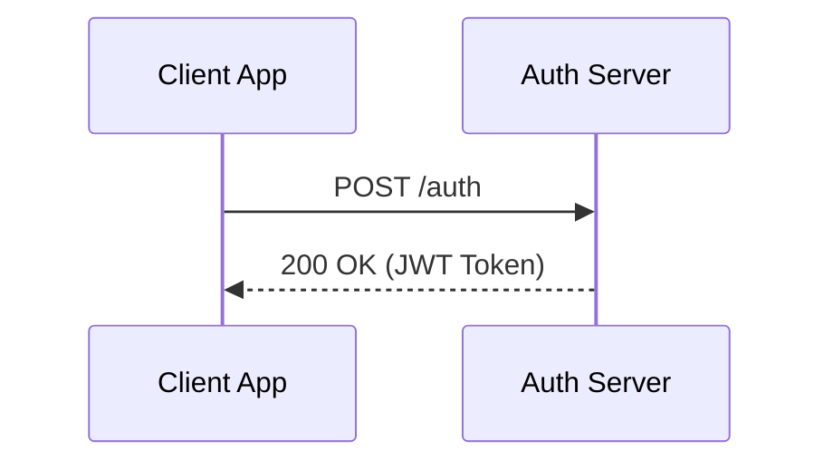

# Presenterm Presentation Authoring Skill

This skill guides the agent in authoring, structuring, formatting, and verifying terminal-based presentations using `presenterm`.

---

## 1. Core Principles & Presentation Structure

`presenterm` is a high-performance terminal slideshow tool written in Rust that renders Markdown slides directly in the terminal using protocols like Kitty Graphics, iTerm2, Sixel, and ASCII fallback.

### Core Guidelines & Rules
> [!CAUTION]
> ### 🚫 ABSOLUTE PROHIBITION ON DOLLAR SIGNS (`$`) OUTSIDE TYPST FENCED BLOCKS
> - **NEVER output dollar signs (`$`, `$$`) in markdown text or list items** (e.g. NEVER write `$Delta y approx f'(x) dot Delta x$`, `$x$`, or `$$...$$`). Presenterm does **NOT** support inline LaTeX or inline Typst. Raw `$ ... $` in text will **NOT render as math**—it will appear literally on the slide as ugly raw text or break slide parsing.
> - **Zero Tolerance for `$ ... $`**:
>   - ❌ **WRONG**: `the slope is $Delta y approx f'(x) dot Delta x$`
>   - ❌ **WRONG**: `where $x$ is the input variable`
>   - ✅ **CORRECT (Formula)**: Put it into a standalone root-level ```` ```typst +render ```` block!
>   - ✅ **CORRECT (In-text scalar variable)**: Use plain Unicode characters (e.g., `x`, `y`, `Δy ≈ f'(x) · Δx`, `x₀`, `α`, `θ`)!

> [!IMPORTANT]
> - **Slide Delimiters**: Delimit and end slides using `<!-- end_slide -->`.
> - **Math Formulas (Typst Only)**: Presenterm uses **Typst** as its rendering engine. **Never use LaTeX syntax** (neither ```` ```latex +render ```` nor inline `$...$`). All math must be written in Typst syntax inside ```` ```typst +render ```` code blocks placed at the root level (0 indentation).
> - **No Indentation for Math Blocks**: Never indent ```` ```typst +render ```` blocks inside bullet points or lists. Place them at root level between list items.
> - **Code Block Placement**: Place code blocks at the root slide level (0 indentation). When displaying code alongside list items, place the code block between separate list sections.
> - **Speaker Notes Syntax**: Always wrap speaker note content in double quotes: `<!-- speaker_note: "Your speaker notes here..." -->`. This ensures robust YAML parsing when text contains colons, quotes, or special characters.
> - **Incremental Lists Syntax**: Always specify an explicit boolean value: `<!-- incremental_lists: true -->` or `<!-- incremental_lists: false -->`.
> - **Reset Layouts**: Always follow a multi-column block with `<!-- reset_layout -->` before normal slide content resumes.
> - **Terminal Overflow Awareness**: Terminal viewports have finite vertical space. Avoid overly verbose slides, excessive blank lines, or large code snippets. Split content across slides or adjust spacing using `<!-- list_item_newlines: N -->`.
> - **HTML Restrictions**: Only `<span>` with inline styles (specifically `color` and `background-color`, e.g. `style="color: palette:red"`) is supported. Arbitrary HTML tags like `<div>`, `<p>`, ``, `<br>` are **not** supported.
> - **Local Media Paths**: Embedded images and files must use paths relative to the presentation markdown file or within its directory hierarchy.

### File Structure & Frontmatter
Every deck begins with a YAML frontmatter block enclosed in `---`. `presenterm` automatically builds a standardized title slide when these properties are defined:

```markdown
---
title: "Distributed System Architecture"
sub_title: "Design Principles & Operations 2026"
author: "Alice Smith"
# Or multiple authors:
# authors:
#   - "Alice Smith"
#   - "Bob Jones"
theme:
  name: catppuccin-mocha
---
```

*(Optional: Configure separate light and dark themes based on terminal background)*:
```yaml
theme:
  light: catppuccin-latte
  dark: catppuccin-mocha
```

### Slide Delimiters & Headings
- **Slide Delimiters**: Delimit and end slides using the `<!-- end_slide -->` comment command.
- **Slide Titles (Setext Level 1)**: Presenterm recognizes Setext level 1 headings (`===` directly underneath the title line). It vertically and horizontally centers the title, applies theme styling, and provides visual emphasis:

```markdown
System Architecture Overview
============================
```

- **Section / Separator Slides**: Combine `<!-- jump_to_middle -->` with a Setext header to produce a clean visual divider slide between major sections:

```markdown
<!-- jump_to_middle -->

Deep Dive: Consensus Algorithms
===============================

<!-- end_slide -->
```

---

## 2. Layout & Comment Commands Reference

Presenterm uses HTML comment commands (`<!-- command -->`) for slide control without introducing HTML tree tags into Markdown.

| Command | Scope | Functionality |
| :--- | :--- | :--- |
| `<!-- end_slide -->` | Current line | Delimits and ends the current slide (mandatory slide separator). |
| `<!-- pause -->` | Current line | Halts rendering until next step keypress. |
| `<!-- incremental_lists: true\|false -->` | Rest of slide | Toggles automatic pause between list bullets (requires explicit boolean). |
| `<!-- list_item_newlines: N -->` | Rest of slide | Sets number of blank lines (`N`) between list bullets to adjust vertical density. |
| `<!-- column_layout: [w1, w2, ...] -->` | Layout block | Splits terminal width into columns with integer ratio weights (e.g. `[1, 1]`, `[1, 2]`). |
| `<!-- column: N -->` | Layout block | Directs subsequent Markdown content into column `N` (0-based index). |
| `<!-- reset_layout -->` | Rest of slide | Closes multi-column mode and restores full slide width. **Required after columns.** |
| `<!-- jump_to_middle -->` | Current line | Moves vertical rendering position down to the center of the terminal. |
| `<!-- new_line -->` | Current line | Inserts exactly 1 blank line (bypasses Markdown blank line collapsing). |
| `<!-- new_lines: N -->` | Current line | Inserts exactly `N` blank lines. Note plural spelling: `new_lines`. |
| `<!-- alignment: left\|center\|right -->` | Rest of slide | Sets horizontal text alignment for all subsequent elements. |
| `<!-- font_size: 1-7 -->` | Rest of slide | Changes font scale (supported on compatible terminals like Kitty v0.40.0+). `1` is default. |
| `<!-- include: path/to/file.md -->` | Insertion point | Transcludes external Markdown file into current slide location. Relative paths are resolved relative to included file. |
| `<!-- speaker_note: "..." -->` | Current slide | Attaches speaker notes for UDP broadcast / presenter view (wrap in double quotes). |
| `<!-- snippet_output: identifier -->` | Insertion point | Renders the captured stdout/stderr from a code block tagged with `+id:identifier`. |
| `<!-- no_footer -->` | Entire slide | Hides footer on the current slide. |
| `<!-- skip_slide -->` | Entire slide | Excludes current slide from the running presentation deck. |
| `<!-- // comment -->` or `<!-- comment: text -->` | N/A | Developer comments / TODOs ignored by presenterm during presentation. |

### Column Layout Pattern
```markdown
Architecture & Code
===================

<!-- column_layout: [1, 1] -->
<!-- column: 0 -->

### Service Responsibilities
* Ingests messages from Kafka.
* Enforces validation logic.
* Dispatches async worker tasks.

<!-- column: 1 -->

```rust +line_numbers
fn handle_event(msg: Message) -> Result<(), Error> {
    validate(&msg)?;
    dispatch(msg)
}
```

<!-- reset_layout -->

This text spans the full width again below the columns.
```

---

## 3. Code Blocks: Highlighting & Execution

Syntax highlighting uses `bat` engine (50+ programming languages supported).

### Line Numbers & Selective / Dynamic Highlighting
- `+line_numbers`: Displays line numbers.
- `{range}`: Selective highlighting. Dim unselected lines to direct focus.
- `{frame1|frame2|...|all}`: Dynamic highlighting. Progresses highlight frames step-by-step on keypress without duplicating code blocks.

```rust +line_numbers {1-2|4|all}
let data = FileReader::open("config.yaml");
let mut cfg = Config::default();
cfg.parse(&data);
println!("Initialized: {:?}", cfg);
```

### External Code Snippets
Load lines from external project files directly into slides:
```file +line_numbers
path: src/server.rs
language: rust
start_line: 15
end_line: 30
```

### Code Execution Directives
> [!NOTE]
> Code execution is disabled by default for security. Run presenterm with `-x` (`--enable-snippet-execution`) or `-X` (`--enable-snippet-execution-replace`).

- `+exec`: Executes on demand when pressing `Ctrl+e`. Output displays in a pane beneath code.
- `+auto_exec`: Runs automatically when the slide is navigated into.
- `+exec_replace`: Automatically executes and **completely replaces** the code block with its stdout/stderr output (ideal for live CLI output, directory trees, dynamic ASCII art).
- `+validate`: Runs the snippet during presentation deck loading; fails with an alert if exit code is non-zero (ideal for verifying presentation integrity).
- `+pty` / `+pty:COLS:ROWS`: Runs interactive code inside a pseudo-terminal (e.g. CLI TUIs). Add `+pty:standby` to pre-allocate display space before execution.

### Snippet Output Redirection (`+id` & `snippet_output`)
Run code in one place (or column) and render its output in another:

````markdown
<!-- column_layout: [1, 1] -->
<!-- column: 0 -->

```bash +exec +id:sys_info
uname -a
```

<!-- column: 1 -->

#### System Kernel Details:
<!-- snippet_output: sys_info -->

<!-- reset_layout -->
````

### Hiding Boilerplate Lines
Hide boilerplate imports or setup lines during presentation while keeping them intact for execution:
- **Rust**: Prefix line with `#`
- **Python / Bash / JS / TS / C / C++ / Go / etc.**: Prefix line with `///`

```python +auto_exec
///import json
///data = {"status": "ok", "service": "auth"}
print("Service running:", data["service"])
```

---

## 4. Diagram & Math Pre-rendering (`+render`)

All diagram/math engines are compiled in background processes via `+render` and support width scaling (`+width:N%`).

### Mermaid Diagram
````markdown

````

### D2 Architecture Diagrams
````markdown
```d2 +render +width:80%
internet: Public Internet { shape: cloud }
lb: Load Balancer { shape: rectangle }
services: Backend Cluster
internet -> lb -> services
```
````

### Math Formulas (Typst)
`presenterm` renders equations through Typst code blocks (`+render`)—never raw LaTeX.

#### 1. Display Equations
Format complex or multi-line equations using ```` ```typst +render ```` blocks placed at root level, with `#set page(fill: none)` so formulas blend with the background:

````markdown
```typst +render +width:60%
#set page(fill: none)
$x = (x_1, ..., x_n)^T in RR^n$
```
````

#### 2. Convert Inline Expressions into Mini Render Blocks
For inline mathematical notation that Unicode cannot cleanly express, break it into a small centered Typst render block:

````markdown
Vector Setting:

```typst +render
#set page(width: auto, height: auto, margin: 0pt, fill: none)
#set text(size: 18pt, fill: rgb("#e2e8f0"))

$ bold(f): RR^n -> RR^m $
```
````

For simple variables inside text sentences, use plain Unicode characters (e.g. `n`, `m`, `x₀`, `α`) rather than dollar-math delimiters.

#### Typst Math Syntax Quick Reference
Typst uses its own native math notation—**not LaTeX**. Do not use backslashes (`\`) or LaTeX macro names. Use standard Typst identifier names and functions:

| Concept | Typst Syntax | LaTeX Equivalent (Do Not Use) |
| :--- | :--- | :--- |
| Function composition | `compose` or `circle.small` | `\circ` |
| Multiplication dot | `dot` | `\cdot` |
| Cross product | `times` | `\times` |
| Bold math symbols | `bold(J)` or `bold(v)` | `\mathbf{J}`, `\boldsymbol{J}` |
| Greek letters | `alpha`, `beta`, `Delta`, `theta`, `phi` | `\alpha`, `\beta`, `\Delta` |
| Number sets | `RR`, `NN`, `ZZ`, `CC` | `\mathbb{R}`, `\mathbb{N}` |
| Arrows / Implies | `arrow`, `arrow.r`, `=>`, `<=>` | `\to`, `\rightarrow`, `\implies`, `\iff` |
| Fractions | `(a) / (b)` | `\frac{a}{b}` |
| Subscripts / Superscripts | `x_0`, `x^2`, `(x_1, ..., x_n)^T` | `x_0`, `x^2`, `x^T` |
| Diagonal dots (matrices) | `dots.down` (or `dots.up`) | `\ddots` |
| Horizontal / Vertical dots | `dots.h` (or `dots`), `dots.v` | `\cdots` / `\ldots`, `\vdots` |
| Matrices | `mat(1, 2; 3, 4)` | `\begin{matrix}...\end{matrix}` |
| Partial derivative | `partial` | `\partial`, `diff` |
| Differential / Gradient | `dif`, `nabla` | `\mathrm{d}`, `\nabla` |
| Square root | `sqrt(x)` | `\sqrt{x}` |
| Integrals / Summations | `integral`, `sum` | `\int`, `\sum` |
| Relations / Approx | `approx`, `eq.def`, `in`, `subset` | `\approx`, `\triangleq`, `\in` |
| Text inside math | `"text in quotes"` | `\text{...}` |

*(Configure formula rendering sharpness via `typst.ppi: 300` in global/deck config).*

---

## 5. Themes, Custom Colors & Footers

### Integrated Themes
- **Catppuccin**: `catppuccin-latte`, `catppuccin-frappe`, `catppuccin-macchiato`, `catppuccin-mocha`
- **Tokyo Night**: `tokyonight-moon`, `tokyonight-day`, `tokyonight-night`, `tokyonight-storm`
- **Others**: `gruvbox-dark`, `dark`, `light`, `terminal-dark`, `terminal-light` (preserves terminal transparency).

### Inline Custom Colors
```markdown
This concept is <span style="color: palette:red">crucial</span> for performance.
```

### Custom 3-Section Footer (YAML Frontmatter)
```yaml
---
theme:
  override:
    footer:
      style: template
      left:
        image: assets/logo.png
      center: "Software Architecture Summit 2026"
      right: "{current_slide} / {total_slides}"
      height: 3
---
```

---

## 6. Speaker Notes, Transitions & Export

### Real-Time Speaker Notes via UDP
Define notes on any slide wrapped in double quotes:
```markdown
<!-- speaker_note: "Remind audience about SLA limits and explain why Redis cache was chosen." -->
```
Or for multi-line notes:
```markdown
<!-- speaker_note: "Remind audience about SLA limits.\nExplain why Redis cache was chosen over Memcached." -->
```

- **Main presentation screen**: `presenterm -P slides.md` (or `--publish-speaker-notes`)
- **Private secondary monitor**: `presenterm -l slides.md` (or `--listen-speaker-notes`)

### Slide Transitions
```yaml
---
transition:
  duration_millis: 500
  frames: 30
---
```

### CLI Verification & Export Commands

- **Check & Validate Code Snippets**:
```bash
presenterm --validate-snippets slides.md
```

- **Validate Overflow (Prevent terminal text truncation)**:
```bash
presenterm --validate-overflows slides.md
```

- **Export to Single Self-Contained HTML** (bundles fonts & images as base64):
```bash
presenterm -E slides.md -o presentation.html
# or
presenterm --export-html slides.md -o presentation.html
```

- **Export to PDF** (uses `weasyprint`):
```bash
presenterm -e slides.md -o presentation.pdf
# or
presenterm --export-pdf slides.md -o presentation.pdf
```

- **List Built-in Comment Commands**:
```bash
presenterm --list-comment-commands
```
